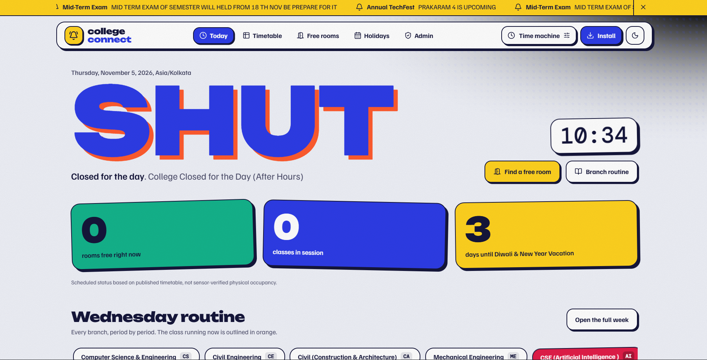
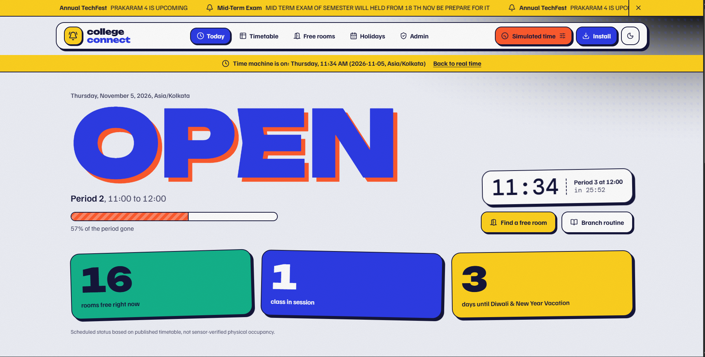
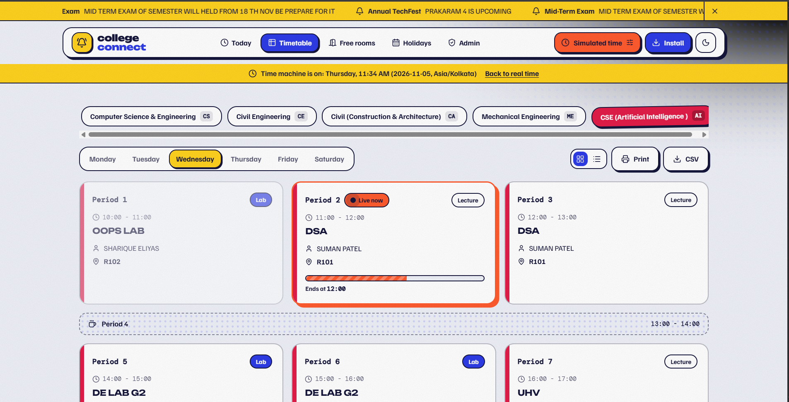
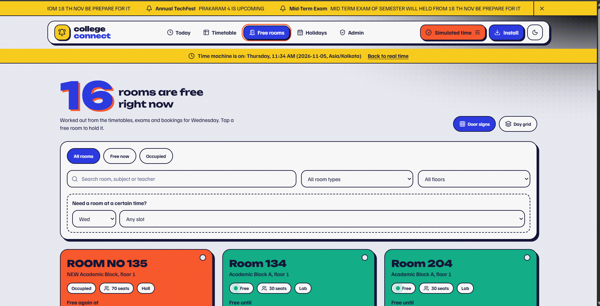
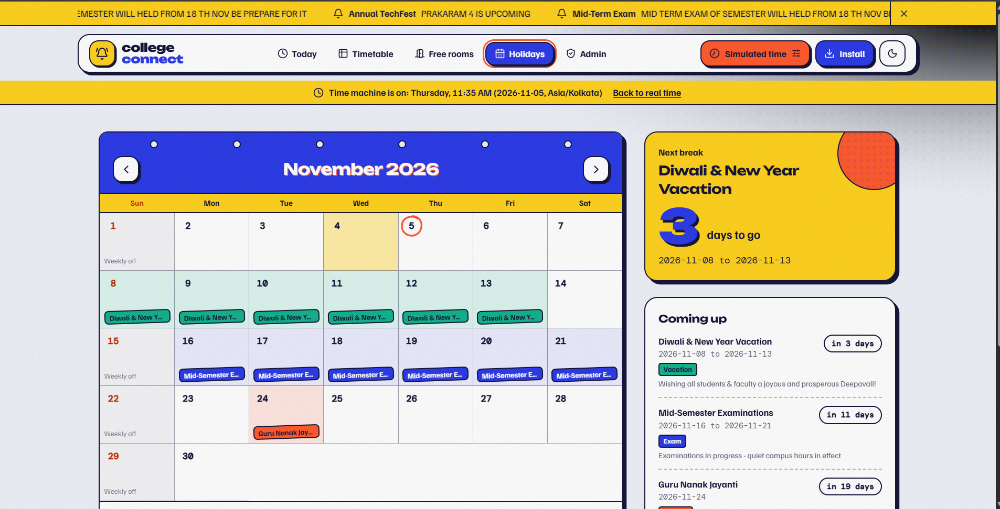
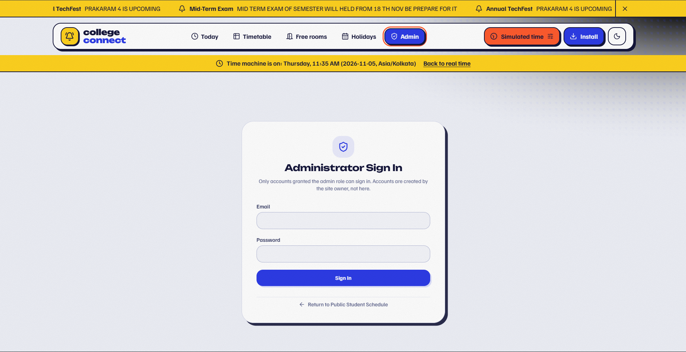
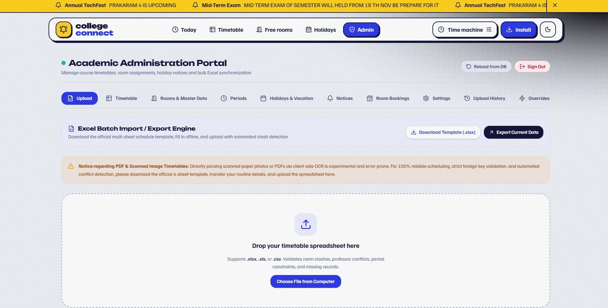
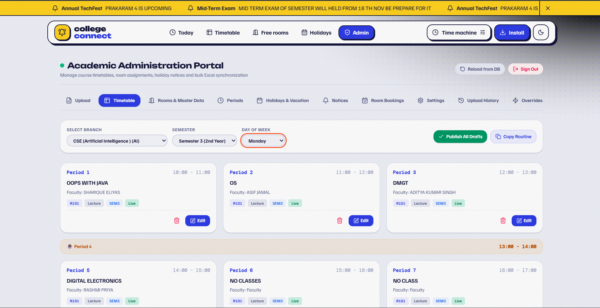

<div align="center">

# 🎓 College Connect

### Smart College Management & Campus Operations Platform

**A modern digital solution for academic scheduling, classroom availability, room reservations, and campus administration.**

<br/>

[](https://github.com/avrendrakumar/college-connect/stargazers)
[](https://github.com/avrendrakumar/college-connect/forks)
[](https://github.com/avrendrakumar/college-connect/issues)
[](https://github.com/avrendrakumar/college-connect)

<br/>

[🚀 Explore Repository](https://github.com/avrendrakumar/college-connect) ·
[🐛 Report an Issue](https://github.com/avrendrakumar/college-connect/issues) ·
[⭐ Star This Project](https://github.com/avrendrakumar/college-connect/stargazers)

</div>

---

## 📖 Table of Contents

- [Application Screenshots](#-application-screenshots)

| Section | Section | 
|---|---|
| [About the Project](#-about-the-project) | [Technology Stack](#-technology-stack) |
| [Key Features](#-key-features) | [Project Architecture](#-project-architecture) |
| [Application Modules](#-application-modules) | [Installation Guide](#-installation-guide) |
| [Database Setup](#-supabase-database-setup) | [Admin Configuration](#-administrator-configuration) |
| [Testing](#-testing) | [Deployment](#-deployment) |
| [Security](#-security) | [Known Limitations](#-known-limitations) |
| [Future Roadmap](#-future-roadmap) | [Contributing](#-contributing) |
| [Author](#-author) | [License](#-license) |

---

## 🌟 About the Project

**College Connect** is a smart college management and campus operations web application developed to make academic scheduling and campus resource management easier.

Traditional college operations often involve manually checking timetables, classroom availability, holidays, and administrative notices. College Connect brings these activities together through a centralized and responsive web platform.

The application provides a public-facing campus dashboard and a dedicated administrator portal backed by Supabase and PostgreSQL.

### 🎯 Project Objectives

- Digitize college timetable management.
- Improve classroom and laboratory utilization.
- Provide real-time room availability information.
- Simplify room reservation and approval workflows.
- Centralize holidays and campus announcements.
- Reduce scheduling conflicts.
- Provide administrators with an organized management interface.

---

## 🖼️ Application Screenshots

Explore the College Connect interface through these application screenshots.

<table>
<tr>
<td width="50%" align="center">
<strong>Screenshot 01</strong><br>

</td>
<td width="50%" align="center">
<strong>Screenshot 02</strong><br>

</td>
</tr>
<tr>
<td width="50%" align="center">
<strong>Screenshot 03</strong><br>

</td>
<td width="50%" align="center">
<strong>Screenshot 04</strong><br>

</td>
</tr>
<tr>
<td width="50%" align="center">
<strong>Screenshot 05</strong><br>

</td>
<td width="50%" align="center">
<strong>Screenshot 06</strong><br>

</td>
</tr>
<tr>
<td width="50%" align="center">
<strong>Screenshot 07</strong><br>

</td>
<td width="50%" align="center">
<strong>Screenshot 08</strong><br>

</td>
</tr>
</table>

---
## ✨ Key Features

<table>
<tr>
<td width="50%">

### 📊 Live Campus Dashboard

- College open/closed status.
- Live clock and period countdown.
- Current academic period.
- Period progress indicator.
- Campus overview.

</td>
<td width="50%">

### 📅 Smart Timetable

- Branch-wise schedules.
- Semester-wise timetable.
- Daily class information.
- Draft and published schedules.
- Routine cloning.
- Clash detection.

</td>
</tr>
<tr>
<td width="50%">

### 🏫 Room Management

- Classroom and laboratory listings.
- Occupied and available status.
- Room capacity and floor details.
- Maintenance status.
- Daily availability heatmap.

</td>
<td width="50%">

### 📝 Room Reservations

- Public booking requests.
- Admin approval and rejection.
- Booking conflict prevention.
- Cancellation management.
- Supabase-powered shared bookings.

</td>
</tr>
<tr>
<td width="50%">

### 🎉 Holiday Management

- College holiday calendar.
- Multi-day vacation scheduling.
- Branch-specific holidays.
- Holiday countdown.

</td>
<td width="50%">

### 📢 Campus Announcements

- Notice ticker.
- Emergency closure controls.
- Campus-wide closure alerts.
- Configurable notice periods.

</td>
</tr>
<tr>
<td width="50%">

### 📥 Excel & CSV Import

- Six-sheet Excel template.
- XLSX, XLS and CSV support.
- Bulk timetable import.
- Replace and merge modes.
- Conflict validation.
- Upload history and undo.

</td>
<td width="50%">

### ⚙️ Administration

- Branch and subject management.
- Faculty and professor records.
- Classroom management.
- Academic period configuration.
- College settings.
- Booking management.

</td>
</tr>
</table>

---

## 🖥️ Application Modules

| Module | Description | Access |
|---|---|---|
| Campus Dashboard | College status and academic overview | Public |
| Branch Timetable | Branch and semester schedules | Public |
| Room Availability | Classroom and lab availability | Public |
| Free Rooms | Room booking requests | Public |
| Holiday Calendar | College holidays and vacations | Public |
| Announcements | Campus notices and alerts | Public |
| Upload Manager | Excel/CSV timetable imports | Admin |
| Timetable Editor | Create and publish schedules | Admin |
| Room Manager | Manage rooms and laboratories | Admin |
| Master Data | Branches, subjects and faculty | Admin |
| Period Manager | Configure academic periods | Admin |
| Holiday Manager | Configure holidays and vacations | Admin |
| Notice Manager | Manage announcements and closures | Admin |
| Room Bookings | Approve, reject and cancel bookings | Admin |
| College Settings | Configure college information and timings | Admin |

---

## 🛠️ Technology Stack

### Frontend

| Technology | Purpose |
|---|---|
| React 19 | Component-based UI |
| TypeScript | Type-safe development |
| Vite 8 | Development and production build |
| Tailwind CSS 4 | Responsive styling |
| Lucide React | Interface icons |
| Motion | UI animations |

### Backend & Database

| Technology | Purpose |
|---|---|
| Supabase | Backend services |
| PostgreSQL | Relational database |
| Supabase Auth | User authentication |
| Row Level Security | Database access control |
| Supabase Realtime | Shared booking updates |

### Tools & Deployment

| Technology | Purpose |
|---|---|
| SheetJS | Excel and CSV processing |
| Vitest | Automated testing |
| Git & GitHub | Version control |
| Vercel | Deployment platform |
| Service Worker | Offline application caching |

---

## 🏗️ Project Architecture

```text
college-connect/
│
├── public/
│   ├── icon.svg
│   ├── manifest.json
│   ├── sw.js
│   └── _redirects
│
├── src/
│   ├── components/
│   │   ├── AdminPanel/
│   │   │   ├── AdminLayout.tsx
│   │   │   ├── BookingsManager.tsx
│   │   │   ├── HolidayManager.tsx
│   │   │   ├── MasterDataManager.tsx
│   │   │   ├── NoticeManager.tsx
│   │   │   ├── PeriodsManager.tsx
│   │   │   ├── RoomManager.tsx
│   │   │   ├── TimetableEditor.tsx
│   │   │   └── UploadZone.tsx
│   │   │
│   │   ├── BranchTimetable.tsx
│   │   ├── HeroBanner.tsx
│   │   ├── HolidayCalendar.tsx
│   │   ├── RoomAvailability.tsx
│   │   ├── NoticeTicker.tsx
│   │   └── SetupChecker.tsx
│   │
│   ├── hooks/
│   ├── services/
│   │   ├── storageService.ts
│   │   └── supabaseClient.ts
│   │
│   ├── types/
│   ├── utils/
│   │   ├── bookingUtils.ts
│   │   ├── dbMapping.ts
│   │   ├── excelEngine.ts
│   │   └── timeEngine.ts
│   │
│   ├── App.tsx
│   ├── index.css
│   └── main.tsx
│
├── supabase/
│   ├── migrations/
│   │   ├── 001_schema.sql
│   │   └── 002_room_bookings.sql
│   └── cleanup_sample_data.sql
│
├── tests/
│   ├── config.test.ts
│   └── schedule.test.ts
│
├── .env.example
├── .gitignore
├── package.json
├── tsconfig.json
├── vite.config.ts
├── vercel.json
└── README.md
```

---

## ⚙️ Installation Guide

### Prerequisites

Install these tools before starting:

- [Node.js](https://nodejs.org/)
- [Git](https://git-scm.com/)
- [Supabase Account](https://supabase.com/)
- Code editor such as [Visual Studio Code](https://code.visualstudio.com/)

### 1. Clone the repository

```bash
git clone https://github.com/avrendrakumar/college-connect.git
```

Navigate to the project:

```bash
cd college-connect
```

### 2. Install dependencies

```bash
npm install
```

### 3. Configure Supabase

Create a project using [Supabase](https://supabase.com/).

Navigate to the Supabase Dashboard and open:

**SQL Editor → New Query**

Execute the migration files in this exact order:

1. `supabase/migrations/001_schema.sql`
2. `supabase/migrations/002_room_bookings.sql`

### 4. Configure environment variables

Create a `.env.local` file in the project root.

Add your Supabase credentials:

```env
VITE_SUPABASE_URL=https://your-project.supabase.co
VITE_SUPABASE_ANON_KEY=your-public-anon-key
```

The `.env.local` file is intentionally excluded from Git.

Never expose your Supabase service-role key in frontend code.

### 5. Start the development server

```bash
npm run dev
```

Open the application:

**http://localhost:3000**

---

## 🗄️ Supabase Database Setup

College Connect uses PostgreSQL through Supabase.

### Database migrations

| File | Purpose |
|---|---|
| `001_schema.sql` | Main database schema, relationships and security policies |
| `002_room_bookings.sql` | Room bookings and opening-hours functionality |
| `cleanup_sample_data.sql` | Optional sample-data cleanup |

### Authentication and Administrator Setup

1. Open Supabase Dashboard.
2. Navigate to Authentication → Users.
3. Create the administrator account.
4. Disable public sign-ups if the application is intended for controlled college access.
5. Open SQL Editor.
6. Promote the appropriate account to administrator:

```sql
UPDATE public.profiles
SET role = 'admin'
WHERE id = (
    SELECT id
    FROM auth.users
    WHERE email = 'YOUR_EMAIL@example.com'
);
```

7. Return to College Connect.
8. Use the Setup Checker to re-check database connectivity and administrator access.

**Important:** Only promote trusted accounts to administrator.

---

## 🧪 Testing & Development

### Available npm scripts

| Command | Description |
|---|---|
| `npm run dev` | Start development server |
| `npm run build` | Create production build |
| `npm run preview` | Preview production build |
| `npm run lint` | Run TypeScript checks |
| `npm run typecheck` | Run TypeScript checks |
| `npm test` | Execute automated tests |

### Run automated tests

```bash
npm test
```

The test suite covers:

- Academic period calculations.
- College open/closed status.
- Holiday and vacation logic.
- Branch-specific holidays.
- Room and professor scheduling conflicts.
- Room availability calculations.
- Database mapping utilities.

### Build the project

```bash
npm run build
```

The generated production files are placed in the `dist/` directory.

---

## 🌐 Deployment

College Connect includes Vercel configuration.

### Deploy using Vercel

1. Push the project to GitHub.
2. Visit [Vercel](https://vercel.com/).
3. Import the `college-connect` repository.
4. Configure the environment variables:

   - `VITE_SUPABASE_URL`
   - `VITE_SUPABASE_ANON_KEY`

5. Deploy the application.
6. Verify authentication and database connectivity.

---

## 🔐 Security & Data Protection

Security is an important part of College Connect.

- Supabase authentication for administrator access.
- PostgreSQL Row Level Security policies.
- Database-backed role verification.
- Database-enforced booking constraints.
- Environment variables excluded from Git.
- No hardcoded default administrator credentials.
- Validation of booking and scheduling conflicts.

Always review database security policies before deploying to production.

---

## ⚠️ Known Limitations

The following limitations are documented in the current project:

- PDF/image timetable OCR is not implemented.
- Browser push notifications are not implemented.
- Working-day configuration has a documented limitation in the timetable day navigation.
- The weekly timetable interface currently displays Monday through Saturday.
- Public room booking requests do not require student authentication.
- The Excel `xlsx` dependency has published security advisories; review its version and security status before production use.

---

## 🚀 Future Roadmap

Potential improvements for future versions:

- [ ] Student registration and personalized dashboards.
- [ ] Faculty login and faculty dashboard.
- [ ] Student attendance management.
- [ ] Academic performance tracking.
- [ ] PDF timetable extraction.
- [ ] Push notifications.
- [ ] Enhanced student-faculty communication.
- [ ] Advanced academic analytics.
- [ ] Improved mobile experience.

These are planned enhancements, not currently implemented features.

---

## 🤝 Contributing

Contributions, suggestions, and bug reports are welcome.

1. Fork the repository.
2. Create a new branch:

```bash
git checkout -b feature/your-feature-name
```

3. Make your changes.
4. Commit your changes:

```bash
git commit -m "Add: your feature description"
```

5. Push your branch:

```bash
git push origin feature/your-feature-name
```

6. Open a Pull Request.

For bugs or suggestions, use the [GitHub Issues](https://github.com/avrendrakumar/college-connect/issues) page.

---

## 👨‍💻 Author

**Avrendra Kumar**

Developer | Engineering Student | Technology Enthusiast

Interested in software development, web technologies, database systems, and building practical digital solutions.

### Connect

- GitHub: [@avrendrakumar](https://github.com/avrendrakumar)
- Project: [College Connect](https://github.com/avrendrakumar/college-connect)

---

## 📜 License

No open-source license has been assigned to this repository yet.

All rights are reserved by the project owner unless a license is added.

---

<div align="center">

### ⭐ If you like this project, consider giving it a star!

**Built with ❤️ to make college management smarter.**

[⬆ Back to Top](#-college-connect)

</div>

